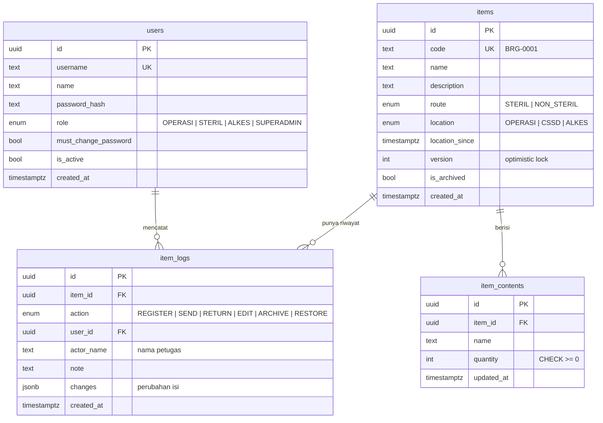

# 03 — ERD & Skema Data

Empat tabel. Tidak ada `organization_id`, tidak ada tabel lampiran.



## Enum

| Enum | Nilai |
|---|---|
| `Role` | `OPERASI`, `STERIL`, `ALKES`, `SUPERADMIN` |
| `Route` | `STERIL`, `NON_STERIL` |
| `Location` | `OPERASI`, `CSSD`, `ALKES` |
| `LogAction` | `REGISTER`, `SEND`, `RETURN`, `EDIT`, `ARCHIVE`, `RESTORE` |

## Skema (ringkas)

```sql
CREATE TABLE users (
  id            uuid PRIMARY KEY DEFAULT gen_random_uuid(),
  username      text NOT NULL UNIQUE,
  name          text NOT NULL,
  password_hash text NOT NULL,
  role          "Role" NOT NULL,
  must_change_password boolean NOT NULL DEFAULT true,
  is_active     boolean NOT NULL DEFAULT true,
  created_at    timestamptz NOT NULL DEFAULT now()
);

CREATE SEQUENCE item_code_seq;

CREATE TABLE items (
  id             uuid PRIMARY KEY DEFAULT gen_random_uuid(),
  code           text NOT NULL UNIQUE
                 DEFAULT 'BRG-' || lpad(nextval('item_code_seq')::text, 4, '0'),
  name           text NOT NULL,
  description    text,
  route          "Route" NOT NULL DEFAULT 'STERIL',
  location       "Location" NOT NULL DEFAULT 'OPERASI',
  location_since timestamptz NOT NULL DEFAULT now(),
  version        int NOT NULL DEFAULT 1,
  is_archived    boolean NOT NULL DEFAULT false,
  created_at     timestamptz NOT NULL DEFAULT now()
);

CREATE TABLE item_contents (
  id         uuid PRIMARY KEY DEFAULT gen_random_uuid(),
  item_id    uuid NOT NULL REFERENCES items(id),
  name       text NOT NULL,
  quantity   int  NOT NULL CHECK (quantity >= 0),
  updated_at timestamptz NOT NULL DEFAULT now(),
  UNIQUE (item_id, name)
);

CREATE TABLE item_logs (
  id         uuid PRIMARY KEY DEFAULT gen_random_uuid(),
  item_id    uuid NOT NULL REFERENCES items(id),
  action     "LogAction" NOT NULL,
  user_id    uuid NOT NULL REFERENCES users(id),
  actor_name text NOT NULL,
  note       text,
  changes    jsonb,
  created_at timestamptz NOT NULL DEFAULT now()
);
CREATE INDEX ON item_logs (item_id, created_at DESC);
CREATE INDEX ON items (location) WHERE NOT is_archived;
```

## Bentuk `changes`

```json
[
  { "name": "Jarum", "from": 10, "to": 8 },
  { "name": "Pisau",  "from": null, "to": 3 },
  { "name": "Gunting", "from": 2, "to": null }
]
```

`from: null` = baris baru, `to: null` = baris dihapus.

## Aturan integritas

1. **Riwayat append-only.** Peran basis data aplikasi hanya diberi `INSERT, SELECT` pada
   `item_logs`; `UPDATE` dan `DELETE` dicabut.
2. **Perpindahan lokasi bersyarat.** Kirim:
   `UPDATE items SET location = CASE route WHEN 'STERIL' THEN 'CSSD' ELSE 'ALKES' END, version=version+1
   WHERE id=$1 AND location='OPERASI'`. Nol baris terpengaruh → 409. Pengembalian:
   `WHERE location IN ('CSSD','ALKES')` dengan hasil `OPERASI`. Tujuan tidak dikirim klien,
   jadi `NON_STERIL` tak mungkin masuk CSSD.
3. **Pengembalian atomik.** Update lokasi, update jumlah, dan penulisan log dalam satu
   transaksi.
4. **Penguncian optimistis.** Ubah isi mengirim `version`; tidak cocok → 409.
5. `location_since` diperbarui setiap kali lokasi berubah (untuk kolom "sudah berapa lama").
6. Barang tidak pernah dihapus; hanya `is_archived`.
7. Barang terarsip tidak dapat dikirim/dikembalikan.
8. `route` hanya dapat diubah saat barang di Operasi.
9. Selalu ada minimal satu `SUPERADMIN` aktif (diperiksa di servis pengguna).
