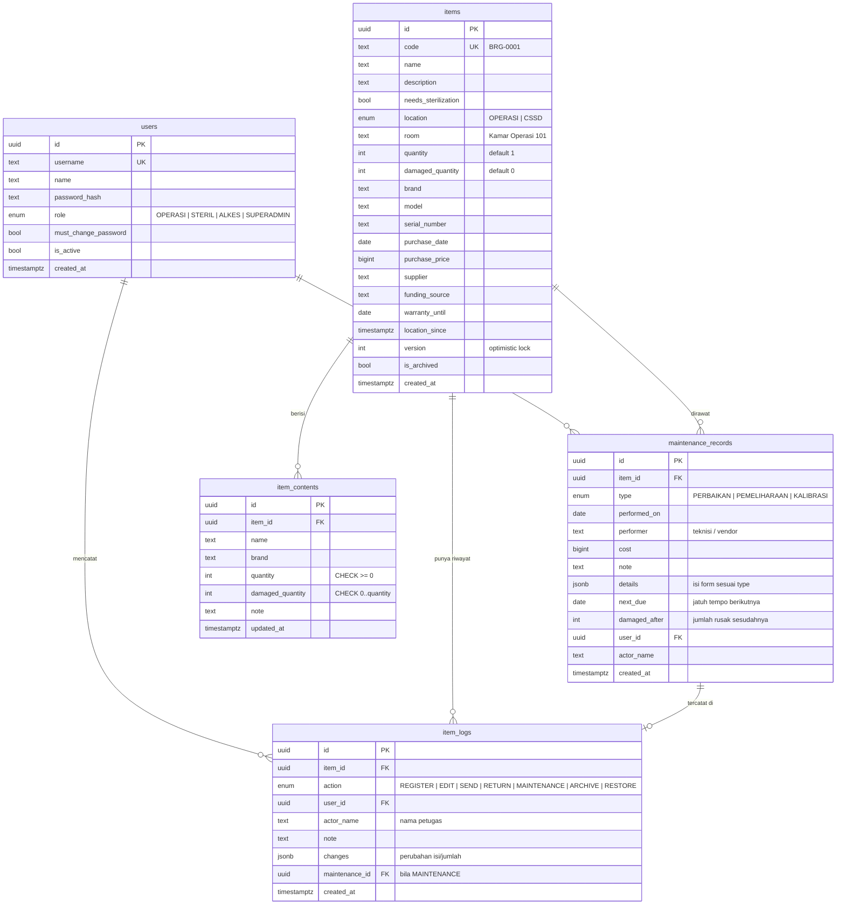

# 03 — ERD & Skema Data

Lima tabel. Tidak ada `organization_id`, tidak ada tabel lampiran/gambar.



## Enum

| Enum | Nilai |
|---|---|
| `Role` | `OPERASI`, `STERIL`, `ALKES`, `SUPERADMIN` |
| `Location` | `OPERASI`, `CSSD` |
| `LogAction` | `REGISTER`, `EDIT`, `SEND`, `RETURN`, `MAINTENANCE`, `ARCHIVE`, `RESTORE` |
| `MaintenanceType` | `PERBAIKAN`, `PEMELIHARAAN`, `KALIBRASI` |

## Mengapa kolom ini ada (dari daftar contoh)

Lihat [12 — Data Contoh](12-data-contoh.md).

- `room` — daftar Juni dikelompokkan per kamar (Kamar Operasi 101, 102, RR, Ruang Transit).
- `brand`, `model`, `serial_number`, `purchase_*`, `supplier`, `warranty_until` — detail
  pembelian barang besar (mesin anestesi, meja operasi, lampu operasi, USG).
- `item_contents.brand` — daftar Mei mencatat merek per instrumen (Aesculap, B.Braun, Storz).
- `damaged_quantity` + `note` — kolom "Alat Rusak" dan "Keterangan" pada daftar Juni.
  Jumlah baik = `quantity − damaged_quantity`.
- `items.quantity` / `damaged_quantity` — barang sejenis tanpa nomor seri dicatat per jumlah di daftar Mei
  ("Meja Stainless 4", "Tempat sampah 2"); satu QR untuk kelompok itu. Alat bernomor seri
  satu QR per unit. Kondisi RUSAK = `damaged_quantity > 0`.

## Skema (ringkas)

```sql
CREATE TABLE users (
  id            uuid PRIMARY KEY DEFAULT gen_random_uuid(),
  username      text NOT NULL UNIQUE,
  name          text NOT NULL,
  password_hash text NOT NULL,
  role          "Role" NOT NULL,
  must_change_password boolean NOT NULL DEFAULT true,
  is_active     boolean NOT NULL DEFAULT true,
  created_at    timestamptz NOT NULL DEFAULT now()
);

CREATE SEQUENCE item_code_seq;

CREATE TABLE items (
  id             uuid PRIMARY KEY DEFAULT gen_random_uuid(),
  code           text NOT NULL UNIQUE
                 DEFAULT 'BRG-' || lpad(nextval('item_code_seq')::text, 4, '0'),
  name           text NOT NULL,
  description    text,
  needs_sterilization boolean NOT NULL,
  location       "Location" NOT NULL DEFAULT 'OPERASI',
  room           text,
  quantity       int NOT NULL DEFAULT 1 CHECK (quantity >= 0),
  damaged_quantity int NOT NULL DEFAULT 0,
  brand          text,
  model          text,
  serial_number  text,
  purchase_date  date,
  purchase_price bigint CHECK (purchase_price >= 0),   -- rupiah, tanpa desimal
  supplier       text,
  funding_source text,
  warranty_until date,
  location_since timestamptz NOT NULL DEFAULT now(),
  version        int NOT NULL DEFAULT 1,
  is_archived    boolean NOT NULL DEFAULT false,
  created_at     timestamptz NOT NULL DEFAULT now(),
  CHECK (damaged_quantity BETWEEN 0 AND quantity),
  CHECK (serial_number IS NULL OR quantity = 1),       -- satu QR = satu unit bernomor seri
  CHECK (needs_sterilization OR location = 'OPERASI')  -- barang tanpa steril tidak pernah ke CSSD
);

CREATE TABLE item_contents (
  id               uuid PRIMARY KEY DEFAULT gen_random_uuid(),
  item_id          uuid NOT NULL REFERENCES items(id),
  name             text NOT NULL,
  brand            text,
  quantity         int  NOT NULL CHECK (quantity >= 0),
  damaged_quantity int  NOT NULL DEFAULT 0,
  note             text,
  updated_at       timestamptz NOT NULL DEFAULT now(),
  CHECK (damaged_quantity BETWEEN 0 AND quantity),
  UNIQUE (item_id, name)
);

CREATE TABLE maintenance_records (
  id              uuid PRIMARY KEY DEFAULT gen_random_uuid(),
  item_id         uuid NOT NULL REFERENCES items(id),
  type            "MaintenanceType" NOT NULL,
  performed_on    date NOT NULL,
  performer       text NOT NULL,
  cost            bigint CHECK (cost >= 0),
  note            text,
  details         jsonb NOT NULL,
  next_due        date,
  damaged_after   int NOT NULL CHECK (damaged_after >= 0),
  user_id         uuid NOT NULL REFERENCES users(id),
  actor_name      text NOT NULL,
  created_at      timestamptz NOT NULL DEFAULT now()
);
CREATE INDEX ON maintenance_records (item_id, performed_on DESC);
CREATE INDEX ON maintenance_records (next_due) WHERE next_due IS NOT NULL;

CREATE TABLE item_logs (
  id             uuid PRIMARY KEY DEFAULT gen_random_uuid(),
  item_id        uuid NOT NULL REFERENCES items(id),
  action         "LogAction" NOT NULL,
  user_id        uuid NOT NULL REFERENCES users(id),
  actor_name     text NOT NULL,
  note           text,
  changes        jsonb,
  maintenance_id uuid REFERENCES maintenance_records(id),
  created_at     timestamptz NOT NULL DEFAULT now()
);
CREATE INDEX ON item_logs (item_id, created_at DESC);
CREATE INDEX ON items (location) WHERE NOT is_archived;
```

## Bentuk `changes`

```json
[
  { "name": "Jarum", "field": "quantity", "from": 10, "to": 8 },
  { "name": "Jarum", "field": "damaged_quantity", "from": 0, "to": 1 },
  { "name": "Pisau", "field": "quantity", "from": null, "to": 3 },
  { "name": "Gunting", "field": "quantity", "from": 2, "to": null }
]
```

`from: null` = baris baru, `to: null` = baris dihapus. `field` ∈ `quantity`,
`damaged_quantity`, `brand`, `note`. Perubahan jumlah/jumlah rusak pada barang itu sendiri
(bukan isi) memakai `name` = nama barang.

## Bentuk `maintenance_records.details` (per jenis)

| Jenis | Isi `details` |
|---|---|
| `PERBAIKAN` | `complaint` (keluhan/kerusakan), `action` (tindakan), `parts` (suku cadang diganti, teks), `finished_on` (tanggal selesai, opsional) |
| `PEMELIHARAAN` | `activities` (kegiatan yang dilakukan, teks), `findings` (temuan) |
| `KALIBRASI` | `institution` (lembaga), `certificate_no`, `result` (`LULUS` \| `TIDAK_LULUS`), `valid_until` |

Divalidasi dengan skema Zod per jenis. `next_due` terisi dari `valid_until` (kalibrasi) atau dari
isian "jadwal berikutnya" (pemeliharaan). `damaged_after` mengubah `items.damaged_quantity` (tidak boleh melebihi `quantity`).

## Aturan integritas

<<<<<<< HEAD
1. **Riwayat append-only.** Peran basis data aplikasi hanya diberi `INSERT, SELECT` pada
   `item_logs` dan `maintenance_records`; `UPDATE` dan `DELETE` dicabut. Salah isi maintenance
   dikoreksi dengan catatan baru.
=======
1. **Riwayat append-only.** Trigger `BEFORE UPDATE OR DELETE` dan `BEFORE TRUNCATE` pada
   `item_logs` dan `maintenance_records` melempar galat, jadi berlaku untuk semua peran basis
   data termasuk pemilik tabel (lebih kuat daripada mencabut hak, dan teruji tanpa peran
   khusus). Salah isi maintenance dikoreksi dengan catatan baru.
>>>>>>> origin/main
2. **Perpindahan lokasi bersyarat.** Hanya barang `needs_sterilization`.
   - Kirim (OPERASI): `UPDATE items SET location='CSSD', version=version+1
     WHERE id=$1 AND location='OPERASI' AND needs_sterilization`.
   - Kembali (STERIL): `... SET location='OPERASI' WHERE id=$1 AND location='CSSD'`.
   - Nol baris terpengaruh → 409. Barang tanpa sterilisasi tidak punya jalur perpindahan.
3. **Pengembalian atomik.** Update lokasi, update jumlah, dan penulisan log dalam satu
   transaksi. Begitu juga maintenance: insert record + update `damaged_quantity` + insert log.
4. **Penguncian optimistis.** Ubah isi mengirim `version`; tidak cocok → 409.
5. `location_since` diperbarui setiap kali lokasi berubah.
6. Barang tidak pernah dihapus; hanya `is_archived`. Terarsip tidak dapat dikirim/dikembalikan.
7. `needs_sterilization` hanya dapat diubah saat barang di Operasi.
8. Selalu ada minimal satu `SUPERADMIN` aktif.
9. `serial_number` yang sudah dipakai barang lain memunculkan peringatan (bukan penolakan).
10. "Terakhir dicek CSSD" dihitung dari log `RETURN` terakhir, bukan kolom sendiri.
