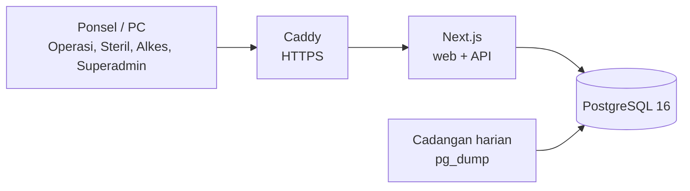
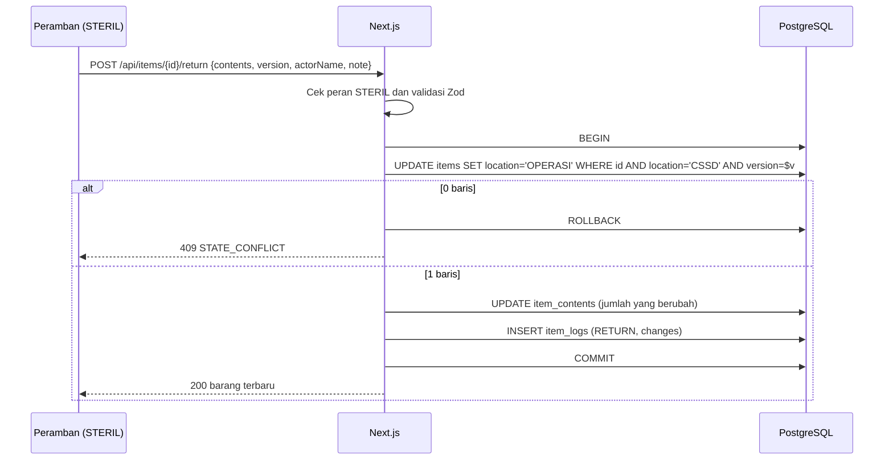

# 04 — Arsitektur Teknis

## 1. Stack

| Lapisan | Pilihan | Alasan |
|---|---|---|
| Framework | **Next.js 15** (App Router) + TypeScript | Satu basis kode untuk UI dan API |
| UI | Tailwind CSS + shadcn/ui | Komponen dimiliki sendiri |
| Basis data | **PostgreSQL 16** | Transaksi, constraint, JSONB |
| ORM | **Prisma** | Migrasi dan tipe otomatis |
| Autentikasi | **Auth.js v5**, provider kredensial | Cukup untuk 4 peran |
| Validasi | **Zod** | Satu skema untuk form dan server |
| QR | `qrcode` (SVG, server) + `@zxing/browser` (pemindai) | Andal di peramban ponsel |
| Reverse proxy | **Caddy** | HTTPS otomatis |
| Orkestrasi | **Docker Compose** | Tiga kontainer |
| Runtime / tooling | Node 22 LTS, pnpm, Biome | |
| Pengujian | Vitest, Playwright | |
| CI/CD | GitHub Actions | Lint, tes, deploy |
| Log | Pino ke stdout | |

**Dibuang dari versi sebelumnya:** Cloudflare R2/MinIO, pg-boss, Nodemailer, RLS, PWA
offline. Tidak ada tugas terjadwal, tidak ada email, tidak ada penyimpanan objek.

Tidak ada backend terpisah: route handler Next.js sudah cukup.

## 2. Komponen



## 3. Struktur Direktori

```
/
├── docs/
├── prisma/
│   ├── schema.prisma
│   ├── migrations/
│   └── seed.ts                     # 4 akun contoh untuk pengembangan
├── scripts/
│   └── create-user.ts              # pnpm user:create (SUPERADMIN pertama)
├── src/
│   ├── app/
│   │   ├── login/page.tsx
│   │   ├── (app)/                  # butuh sesi
│   │   │   ├── page.tsx            # beranda: hitungan + daftar
│   │   │   ├── scan/page.tsx
│   │   │   ├── users/page.tsx      # hanya SUPERADMIN
│   │   │   └── items/
│   │   │       ├── new/page.tsx
│   │   │       └── [code]/page.tsx # detail, isi, riwayat, tombol aksi
│   │   ├── i/[code]/route.ts       # tujuan QR → alihkan ke /items/[code]
│   │   ├── print/
│   │   │   ├── label/[code]/page.tsx
│   │   │   └── sheet/page.tsx
│   │   └── api/
│   ├── server/
│   │   ├── auth/                   # sesi, guard peran
│   │   ├── db.ts
│   │   └── services/
│   │       ├── item.service.ts     # daftar, daftarkan, ubah, arsip
│   │       ├── user.service.ts     # buat/ubah/nonaktifkan pengguna
│   │       └── flow.service.ts     # send(), return() — satu-satunya pengubah lokasi
│   ├── lib/
│   │   ├── permissions.ts          # matriks peran
│   │   ├── strings.ts              # seluruh teks UI (Indonesia)
│   │   └── validators/
│   └── components/
├── tests/
│   ├── flow.test.ts                # kirim/kembali, konflik, atomik
│   ├── permissions.test.ts
│   └── e2e/
├── .github/workflows/{ci,deploy}.yml
├── docker-compose.yml
├── Caddyfile
├── biome.json
└── .env.example
```

**Aturan struktural:**
- Semua mutasi lewat `src/server/services`. Route handler hanya validasi → cek peran → panggil servis.
- Hanya `flow.service.ts` yang boleh mengubah `items.location`.
- Hanya servis yang menulis `item_logs`, dan selalu dalam transaksi yang sama dengan perubahannya.

## 4. Konvensi

| Hal | Aturan |
|---|---|
| Bahasa kode | Inggris (tabel, kolom, fungsi, komentar, commit) |
| Bahasa UI | Indonesia, terkumpul di `src/lib/strings.ts` |
| Nama paket/database/kontainer | `simaset` |
| Domain | `{DOMAIN}`, dari `APP_URL` |
| Commit | Conventional Commits, branch + PR |

## 5. Alur Teknis Kunci

### 5.1 Pindai QR
`GET /i/BRG-0001` → bila belum login, alihkan ke `/login?next=/items/BRG-0001` → setelah
login, halaman barang terbuka.

### 5.2 Kembalikan ke Operasi (dari CSSD)



### 5.3 Kirim ke CSSD
Sama, tanpa perubahan jumlah: kondisi `location='OPERASI'`, tujuan dihitung server dari
`route` (`STERIL` → CSSD, `NON_STERIL` → ALKES), log `SEND`.

### 5.4 Pengembalian dari Alkes
Sama dengan 5.2 dengan kondisi `location='ALKES'`, dijalankan oleh peran ALKES; tanpa
perubahan jumlah.
