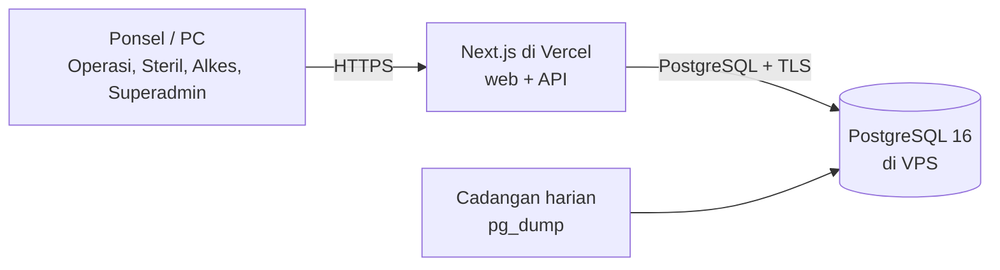
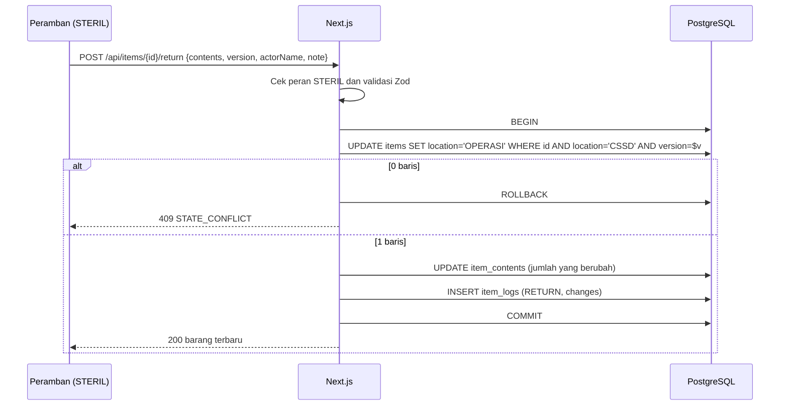
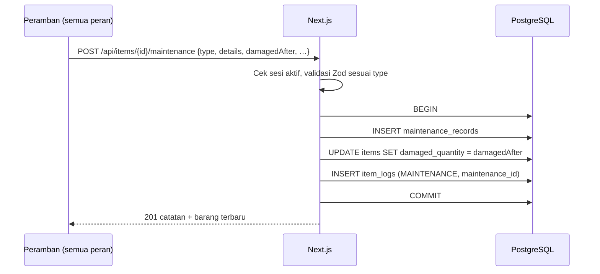

# 04 — Arsitektur Teknis

## 1. Stack

| Lapisan | Pilihan | Alasan |
|---|---|---|
| Framework | **Next.js 15** (App Router) + TypeScript | Satu basis kode untuk UI dan API |
| UI | Tailwind CSS + shadcn/ui | Komponen dimiliki sendiri |
| Basis data | **PostgreSQL 16** | Transaksi, constraint, JSONB |
| ORM | **Prisma** | Migrasi dan tipe otomatis |
| Autentikasi | **Auth.js v5**, provider kredensial | Cukup untuk 4 peran |
| Validasi | **Zod** | Satu skema untuk form dan server |
| QR | `qrcode` (SVG, server) + `@zxing/browser` (pemindai) | Andal di peramban ponsel |
| Hosting aplikasi | **Vercel** | HTTPS otomatis, deploy dari `main` |
| Hosting database | **Docker Compose di VPS** | Satu kontainer PostgreSQL, TLS wajib |
| Runtime / tooling | Node 22 LTS, pnpm, Biome | |
| Pengujian | Vitest, Playwright | |
| CI/CD | GitHub Actions + Vercel | CI: lint, tes, build; Vercel: migrasi + deploy |
| Log | Pino ke stdout | |

**Dibuang dari versi sebelumnya:** Cloudflare R2/MinIO, pg-boss, Nodemailer, RLS, PWA
offline, unggah berkas (termasuk sertifikat). Tidak ada tugas terjadwal, tidak ada email, tidak ada penyimpanan objek.

Tidak ada backend terpisah: route handler Next.js sudah cukup.

## 2. Komponen



## 3. Struktur Direktori

```
/
├── docs/
├── prisma/
│   ├── schema.prisma
│   ├── migrations/
│   └── seed.ts                     # 4 akun contoh untuk pengembangan
├── scripts/
│   ├── create-user.ts              # pnpm user:create (SUPERADMIN pertama)
│   └── import-csv.ts               # pnpm import:csv — pemuatan data awal sekali pakai
├── src/
│   ├── app/
│   │   ├── login/page.tsx
│   │   ├── (app)/                  # butuh sesi
│   │   │   ├── page.tsx            # beranda: hitungan + daftar
│   │   │   ├── scan/page.tsx
│   │   │   ├── users/page.tsx      # hanya SUPERADMIN
│   │   │   └── items/
│   │   │       ├── new/page.tsx
│   │   │       └── [code]/
│   │   │           ├── page.tsx    # detail, isi, riwayat, maintenance, tombol aksi
│   │   │           └── maintenance/new/page.tsx   # 3 form: perbaikan, pemeliharaan, kalibrasi
│   │   ├── i/[code]/route.ts       # tujuan QR → alihkan ke /items/[code]
│   │   ├── print/
│   │   │   ├── label/[code]/page.tsx
│   │   │   └── sheet/page.tsx
│   │   └── api/
│   ├── server/
│   │   ├── auth/                   # sesi, guard peran
│   │   ├── db.ts
│   │   └── services/
│   │       ├── item.service.ts     # daftar, daftarkan, ubah, arsip
│   │       ├── user.service.ts     # buat/ubah/nonaktifkan pengguna
│   │       ├── maintenance.service.ts  # catat maintenance + perbarui jumlah rusak
│   │       └── flow.service.ts     # send(), return() — satu-satunya pengubah lokasi
│   ├── lib/
│   │   ├── permissions.ts          # matriks peran
│   │   ├── strings.ts              # seluruh teks UI (Indonesia)
│   │   └── validators/             # termasuk skema Zod per jenis maintenance
│   └── components/
├── tests/
│   ├── flow.test.ts                # kirim/kembali, konflik, atomik
│   ├── permissions.test.ts
│   └── e2e/
├── .github/workflows/ci.yml
├── docker-compose.yml          # hanya PostgreSQL untuk VPS
├── deploy/pg_hba.conf          # hanya hostssl dari luar
├── vercel.json
├── biome.json
└── .env.example
```

**Aturan struktural:**
- Semua mutasi lewat `src/server/services`. Route handler hanya validasi → cek peran → panggil servis.
- Hanya `flow.service.ts` yang boleh mengubah `items.location`.
- Hanya servis yang menulis `item_logs` dan `maintenance_records`, selalu dalam transaksi yang sama dengan perubahannya.
- Isian `details` maintenance divalidasi dengan skema Zod per jenis sebelum disimpan.

## 4. Konvensi

| Hal | Aturan |
|---|---|
| Bahasa kode | Inggris (tabel, kolom, fungsi, komentar, commit) |
| Bahasa UI | Indonesia, terkumpul di `src/lib/strings.ts` |
| Nama paket/database/kontainer | `simaset` |
| Domain | `{DOMAIN}`, dari `APP_URL` |
| Commit | Conventional Commits, branch + PR |

## 5. Alur Teknis Kunci

### 5.1 Pindai QR
`GET /i/BRG-0001` → halaman publik read-only berisi seluruh informasi barang (identitas,
pembelian, isi, maintenance) yang bisa dibuka siapa saja tanpa login. Bila pengguna sudah
login, langsung dialihkan ke `/items/BRG-0001` untuk mengelola barang. Semua aksi (ubah,
kirim, return, maintenance, arsip) tetap butuh login.

### 5.2 Kembalikan ke Operasi (dari CSSD)



### 5.3 Kirim
Sama, tanpa perubahan jumlah: kondisi `location='OPERASI' AND needs_sterilization`, hasil
`location='CSSD'`, log `SEND`. Barang tanpa sterilisasi tidak punya jalur perpindahan sama sekali.

### 5.4 Mencatat maintenance



Tidak memakai `version` karena maintenance tidak mengubah lokasi atau isi; hanya jumlah rusak
barang, dan pembaruan itu dibatasi `CHECK (damaged_quantity <= quantity)`.

### 5.5 Pemuatan data awal
`pnpm import:csv --items items.csv --contents contents.csv` membuat barang, isi, dan log
`REGISTER` dalam satu transaksi per barang. Dijalankan sekali oleh pengembang/SA; baris
yang gagal divalidasi dilaporkan tanpa menghentikan seluruh impor.
