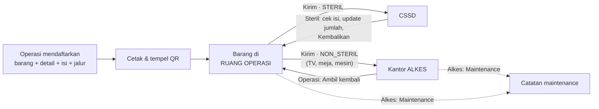
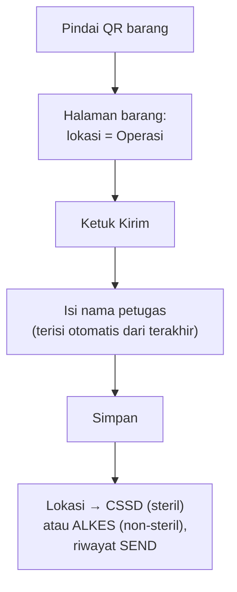
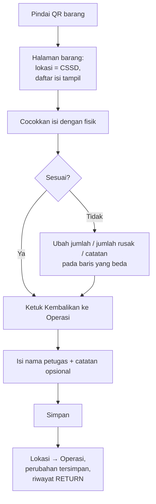
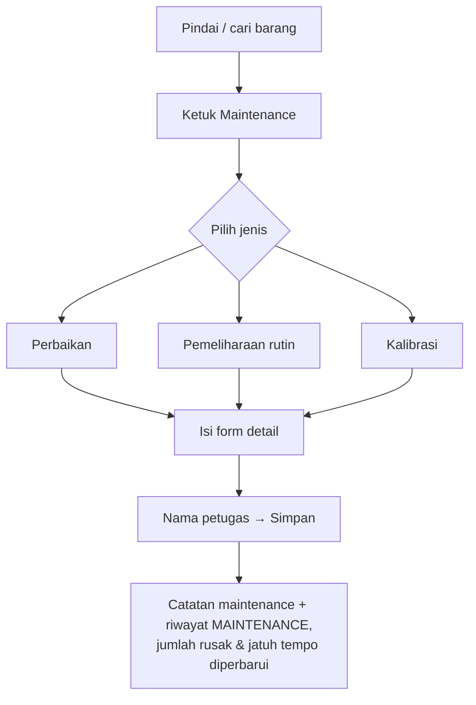

# 05 — Alur Penggunaan

## 1. Peta besar

Dua tombol perpindahan: **Kirim** dan **Kembalikan/Ambil kembali** (selalu menuju Operasi).
Tujuan Kirim otomatis (steril → CSSD, non-steril → Alkes); petugas tidak memilih.
Alkes tidak memindahkan barang: ia melihat dan melakukan **Maintenance**.
Superadmin dapat melakukan semuanya dan mengelola pengguna.

---

## 2. Mendaftarkan barang (Operasi)

1. **Barang → Tambah**.
2. **Identitas:** nama, jalur (*Steril* untuk set/wadah; *Non-steril* untuk alat besar), kamar,
   jumlah (default 1).
3. **Detail alat** (opsional): merek, model, nomor seri.
4. **Pembelian** (opsional): tanggal, harga, supplier, sumber dana, garansi sampai.
5. **Isi** (untuk wadah): **+ Isi** → nama, merek, jumlah, rusak, catatan. Ulangi.
6. **Simpan** → kode `BRG-xxxx` terbit, halaman barang terbuka. **Cetak Label**, tempel.

Alat besar cukup terisi nama + detail; isi dikosongkan. Pendataan awal ratusan barang
dilakukan lewat impor CSV sekali pakai, bukan satu per satu ([12](12-data-contoh.md)).

---

## 3. Mengubah jumlah (Operasi, CSSD)

- **Operasi:** buka barang → **Ubah** → ubah jumlah/rusak/catatan pada barang atau baris isi →
  Simpan. Bisa kapan saja barang tidak di CSSD.
- **CSSD:** lihat bagian 5.

Setiap perubahan tercatat sebagai nilai lama → baru.

---

## 4. Mengirim (Operasi)

Tiga ketukan: **Kirim → (nama petugas) → Simpan**. Catatan opsional.

**Mengambil kembali barang non-steril dari Alkes:** pindai → **Ambil kembali** → nama
petugas → Simpan. Hanya Operasi yang melakukannya.

---

## 5. Pengecekan dan pengembalian (Steril)

Pengubahan dan pengembalian terjadi **dalam satu simpanan**. Item hilang → jumlah dikurangi;
item rusak → isi jumlah rusak; item pengganti → tambah baris. Tulis sebabnya di catatan.

---

## 6. Maintenance (Alkes, Superadmin)

| Jenis | Kapan dipakai | Isian utama |
|---|---|---|
| **Perbaikan** | Alat rusak, mis. meja operasi bocor oli | Keluhan, tindakan, suku cadang, biaya, jumlah rusak setelahnya |
| **Pemeliharaan rutin** | Servis berkala | Kegiatan, temuan, jadwal berikutnya |
| **Kalibrasi** | Alat ukur/medis | Lembaga, nomor sertifikat, hasil, berlaku sampai |

Maintenance bisa dilakukan di lokasi mana pun barang berada, termasuk saat di Operasi.
Barang yang jatuh tempo ≤ 30 hari tampil di Beranda.

---

## 7. Memantau (semua peran)

Beranda: hitungan Operasi / CSSD / Alkes / Rusak / Jatuh tempo, daftar dengan filter dan
pencarian, lalu detail barang (isi, riwayat, maintenance). Peran tanpa wewenang tidak melihat
tombolnya.

---

## 8. Superadmin

- Melakukan semua tindakan peran lain.
- **Pengguna → Tambah:** username, nama, peran, kata sandi awal (wajib diganti saat login
  pertama). Dapat mengubah peran, menonaktifkan, dan mengatur ulang kata sandi.

---

## 9. Hal lain

| Situasi | Tindakan |
|---|---|
| Label rusak/tidak terbaca | Cari lewat kode/nama/seri di kolom cari |
| Cetak ulang label | Halaman barang → Cetak Label (kode tetap) |
| Barang tidak dipakai lagi | Operasi: **Arsipkan**; bisa **Pulihkan** |
| Salah kirim | CSSD (atau Operasi untuk non-steril) mengembalikan dengan catatan "salah kirim" |
| Salah memilih jalur | Operasi mengubah jalur saat barang masih di Operasi |
| Salah isi jumlah/maintenance | Isi lagi; nilai lama tetap di riwayat. Maintenance salah dikoreksi dengan catatan baru |
| Dua orang menyimpan bersamaan | Yang kedua melihat "data sudah berubah", muat ulang |

Riwayat dan catatan maintenance tidak dapat dihapus.

---

## 10. Siapa melakukan apa

| Peran | Tugas |
|---|---|
| **OPERASI** | Daftar & ubah barang/isi/jumlah, cetak label, kirim, ambil kembali (non-steril), arsipkan |
| **STERIL** | Cek isi, update jumlah/rusak, kembalikan barang dari CSSD |
| **ALKES** | Memantau semua; mencatat maintenance (perbaikan, pemeliharaan, kalibrasi) |
| **SUPERADMIN** | Semua di atas + kelola pengguna |
