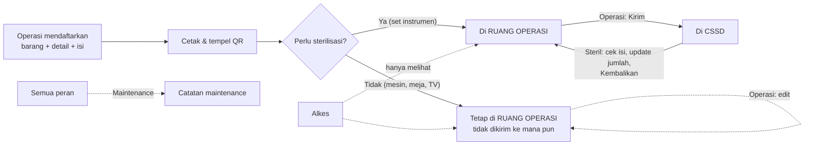
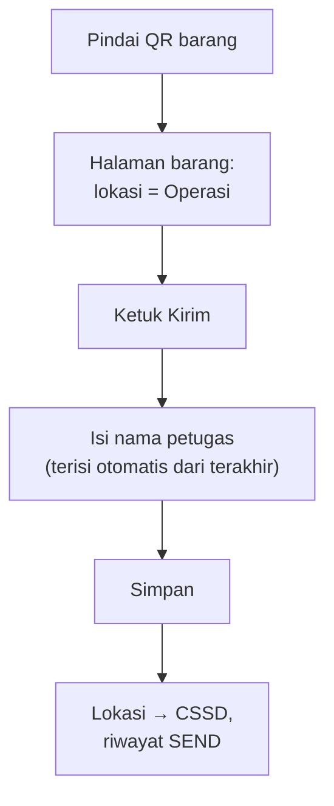
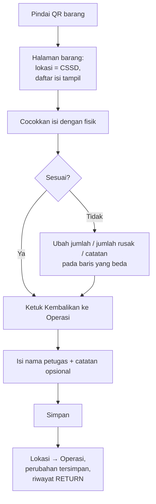
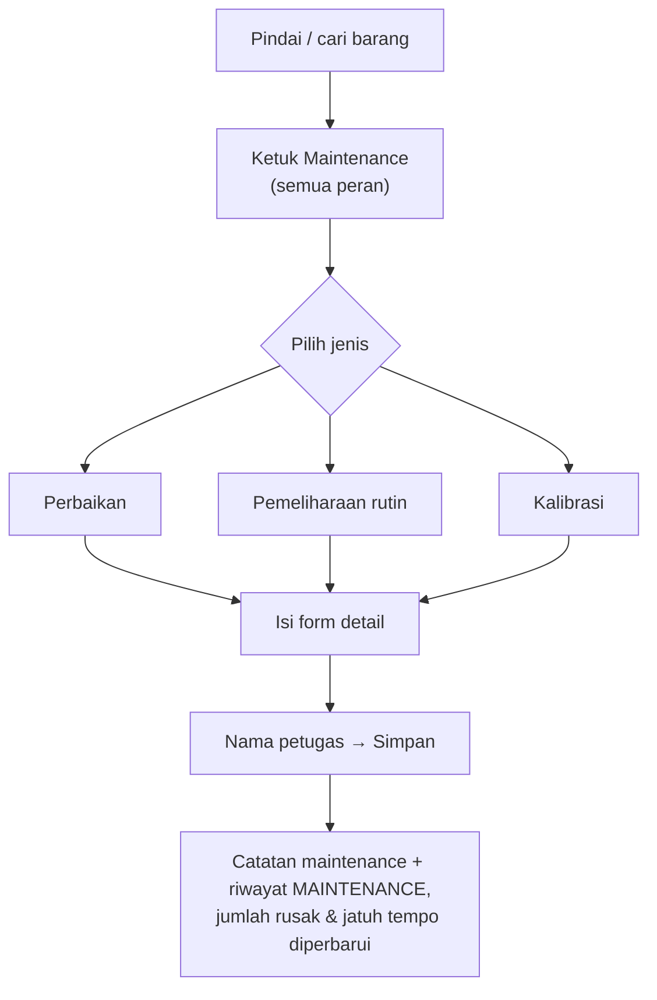

# 05 — Alur Penggunaan

## 1. Peta besar

Dua tombol perpindahan, hanya untuk **set yang perlu sterilisasi**: **Kirim** (Operasi) dan
**Kembalikan** (CSSD). Alat besar tanpa sterilisasi tidak berpindah: Operasi mengeditnya,
Alkes melihatnya. **Maintenance** dapat dicatat semua peran pada barang apa pun.
Superadmin dapat melakukan semuanya dan mengelola pengguna.

---

## 2. Mendaftarkan barang (Operasi)

1. **Barang → Tambah**.
2. **Identitas:** nama, *perlu sterilisasi?* (Ya untuk set/wadah; Tidak untuk alat besar),
   kamar, jumlah (default 1; lebih dari 1 hanya untuk barang sejenis tanpa nomor seri).
3. **Detail alat** (opsional): merek, model, nomor seri.
4. **Pembelian** (opsional): tanggal, harga, supplier, sumber dana, garansi sampai.
5. **Isi** (untuk wadah): **+ Isi** → nama, merek, jumlah, rusak, catatan. Ulangi.
6. **Simpan** → kode `BRG-xxxx` terbit, halaman barang terbuka. **Cetak Label**, tempel.

Alat besar cukup terisi nama + detail; isi dikosongkan. Alat bernomor seri didaftarkan
satu per satu (satu QR per unit); meja stainless 4 buah cukup satu entri berjumlah 4. Pendataan awal ratusan barang
dilakukan lewat impor CSV sekali pakai, bukan satu per satu ([12](12-data-contoh.md)).

---

## 3. Mengubah jumlah (Operasi, CSSD)

- **Operasi:** buka barang → **Ubah** → ubah jumlah/rusak/catatan pada barang atau baris isi →
  Simpan. Berlaku untuk semua barang, kapan saja barang tidak di CSSD (alat besar tanpa
  sterilisasi selalu bisa diubah).
- **CSSD:** lihat bagian 5.

Setiap perubahan tercatat sebagai nilai lama → baru.

---

## 4. Mengirim set ke CSSD (Operasi)

Tiga ketukan: **Kirim → (nama petugas) → Simpan**. Catatan opsional. Barang tanpa
sterilisasi tidak punya tombol Kirim.

---

## 5. Pengecekan dan pengembalian (Steril)

Pengubahan dan pengembalian terjadi **dalam satu simpanan**. Item hilang → jumlah dikurangi;
item rusak → isi jumlah rusak; item pengganti → tambah baris. Tulis sebabnya di catatan.

---

## 6. Maintenance (semua peran)

| Jenis | Kapan dipakai | Isian utama |
|---|---|---|
| **Perbaikan** | Alat rusak, mis. meja operasi bocor oli | Keluhan, tindakan, suku cadang, biaya, jumlah rusak setelahnya |
| **Pemeliharaan rutin** | Servis berkala | Kegiatan, temuan, jadwal berikutnya |
| **Kalibrasi** | Alat ukur/medis | Lembaga, nomor sertifikat, hasil, berlaku sampai |

Maintenance bisa dicatat oleh peran mana pun, di lokasi mana pun barang berada (termasuk
saat di CSSD).
Barang yang jatuh tempo ≤ 30 hari tampil di Beranda.

---

## 7. Memantau (semua peran)

Beranda: hitungan Operasi / CSSD / Rusak / Jatuh tempo, daftar dengan filter dan pencarian,
lalu detail barang (isi, riwayat, maintenance). **Alkes hanya melihat**; peran tanpa wewenang
tidak melihat tombol aksi.

---

## 8. Superadmin

- Melakukan semua tindakan peran lain.
- **Pengguna → Tambah:** username, nama, peran, kata sandi awal (wajib diganti saat login
  pertama). Dapat mengubah peran, menonaktifkan, dan mengatur ulang kata sandi.

---

## 9. Hal lain

| Situasi | Tindakan |
|---|---|
| Label rusak/tidak terbaca | Cari lewat kode/nama/seri di kolom cari |
| Cetak ulang label | Halaman barang → Cetak Label (kode tetap) |
| Barang tidak dipakai lagi | Operasi: **Arsipkan**; bisa **Pulihkan** |
| Salah kirim | CSSD mengembalikan dengan catatan "salah kirim" |
| Salah memilih *perlu sterilisasi* | Operasi mengubahnya saat barang masih di Operasi |
| Salah isi jumlah/maintenance | Isi lagi; nilai lama tetap di riwayat. Maintenance salah dikoreksi dengan catatan baru |
| Dua orang menyimpan bersamaan | Yang kedua melihat "data sudah berubah", muat ulang |

Riwayat dan catatan maintenance tidak dapat dihapus.

---

## 10. Siapa melakukan apa

| Peran | Tugas |
|---|---|
| **OPERASI** | Daftar & ubah barang/isi/jumlah (termasuk alat besar), cetak label, kirim set ke CSSD, arsipkan, maintenance |
| **STERIL** | Cek isi, update jumlah/rusak, kembalikan dari CSSD, maintenance |
| **ALKES** | Melihat semua; maintenance |
| **SUPERADMIN** | Semua di atas + kelola pengguna |
