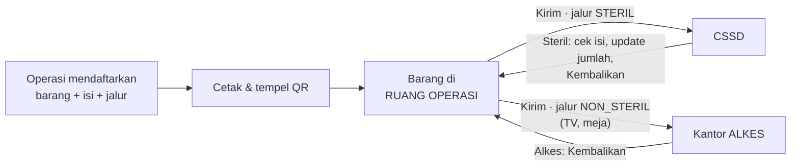
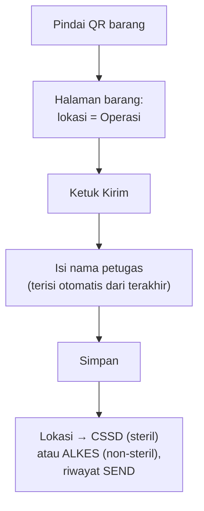
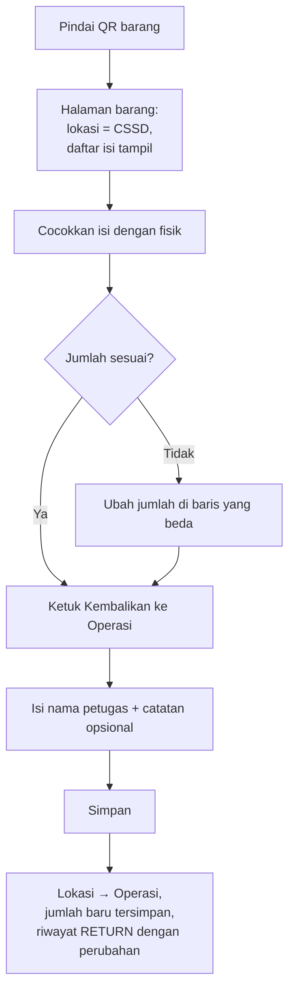

# 05 — Alur Penggunaan

## 1. Peta besar

Hanya ada dua tombol aksi: **Kirim** dan **Kembalikan ke Operasi**. Tujuan Kirim otomatis
(wadah steril → CSSD, barang besar non-steril → Alkes); petugas tidak memilih.
Superadmin dapat melakukan semuanya dan mengelola pengguna.

---

## 2. Mendaftarkan barang (Operasi, sekali per barang)

1. **Barang → Tambah**.
2. Isi **nama** (dan keterangan bila perlu). Pilih **jalur**: *Steril* (wadah/set instrumen) atau *Non-steril* (TV, meja, barang besar lain).
3. Bila wadah: tekan **+ Isi**, tulis nama dan jumlah (jarum 10, pisau 5, …). Ulangi.
4. **Simpan** → kode `BRG-xxxx` terbit, halaman barang terbuka.
5. **Cetak Label** → tempel di barang.

Barang besar seperti TV atau meja: cukup nama, isi dikosongkan.

---

## 3. Mengirim (Operasi)

Tiga ketukan: **Kirim → (nama petugas) → Simpan**. Catatan bersifat opsional.

Operasi juga dapat **mengubah jumlah isi** kapan pun barang masih di Operasi (halaman
barang → Ubah Isi), tidak harus saat mengirim.

---

## 4. Pengecekan dan pengembalian (Steril)

Pengubahan jumlah dan pengembalian terjadi **dalam satu simpanan**. Bila ada barang isi
yang hilang atau diganti, ubah jumlahnya (hilang → 0) atau tambah baris baru, dan tulis
sebabnya di catatan.

---

## 5. Kantor Alkes

**Memantau:** beranda menampilkan tiga angka (**Operasi / CSSD / Alkes**), daftar barang
dengan filter lokasi dan pencarian, serta detail isi dan riwayat.

**Menerima barang non-steril:** barang jalur non-steril yang dikirim Operasi tampil di
Alkes. Bila sudah selesai (disimpan/diperiksa/dipakai di Alkes), pindai barang →
**Kembalikan ke Operasi** → nama petugas → Simpan.

---

## 5b. Superadmin

- Melakukan semua tindakan peran lain.
- **Pengguna → Tambah:** username, nama, peran, kata sandi awal. Pengguna wajib mengganti
  kata sandi saat login pertama.
- Dapat mengubah peran, menonaktifkan, dan mengatur ulang kata sandi pengguna.

---

## 6. Hal lain

| Situasi | Tindakan |
|---|---|
| Label rusak/tidak terbaca | Cari lewat kode/nama di kolom cari |
| Label perlu dicetak ulang | Operasi: halaman barang → Cetak Label (kode tetap sama) |
| Barang tidak dipakai lagi | Operasi: **Arsipkan**; bisa **Pulihkan** kapan saja |
| Salah kirim (barang sebenarnya tidak dikirim) | CSSD/Alkes langsung mengembalikan dengan catatan "salah kirim" |
| Salah memilih jalur | Operasi mengubah jalur saat barang masih di Operasi |
| Salah isi jumlah | Ubah lagi; kedua nilai tetap terlihat di riwayat |
| Dua orang menyimpan bersamaan | Yang kedua melihat "data sudah berubah", muat ulang |

Riwayat tidak dapat dihapus. Koreksi dilakukan dengan perubahan baru yang tercatat.

---

## 7. Siapa melakukan apa

| Peran | Tugas |
|---|---|
| **OPERASI** | Daftar barang, isi & jumlah, jalur; cetak label; kirim; arsipkan |
| **STERIL** | Cek isi, update jumlah, kembalikan barang dari CSSD |
| **ALKES** | Memantau semua; kembalikan barang non-steril dari Alkes |
| **SUPERADMIN** | Semua di atas + kelola pengguna |
