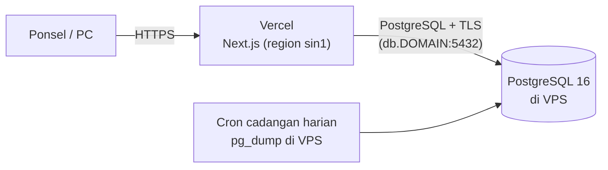

# 09 — Deployment & Operasional

## 1. Arsitektur



- **Vercel** menjalankan seluruh aplikasi Next.js (halaman, server actions, API). Tidak ada
  server aplikasi sendiri yang dirawat.
- **VPS** hanya menjalankan **PostgreSQL** dalam Docker, plus cron cadangan. Datanya (harga
  beli, riwayat) tetap di server milik sendiri.
- Vercel mengakses database lewat internet, jadi koneksi **wajib TLS** dan berkata sandi
  panjang ([§9](#9-keamanan-database-yang-terbuka)).

HTTPS wajib di produksi karena kamera peramban tidak berjalan di HTTP; Vercel menyediakannya
otomatis untuk domain aplikasi. Di lokal, `localhost` dikecualikan.

## 2. Kebutuhan

- **VPS**: 1 vCPU, 1–2 GB RAM, 20 GB disk cukup (hanya teks), dengan IP publik tetap dan
  port 5432 terbuka. Pilih lokasi dekat Indonesia (mis. Singapura) agar selaras dengan region
  fungsi Vercel `sin1` di `vercel.json`.
- **Vercel**: proyek yang terhubung ke repo GitHub. Paket Hobby tidak boleh dipakai untuk
  penggunaan komersial; untuk rumah sakit pakai paket berbayar sesuai kebijakan Vercel.
- **Dua nama domain**: aplikasi (`simaset.<domain>`, ke Vercel) dan database
  (`db.<domain>`, A record ke IP VPS, dipakai sertifikat TLS).

## 3. Variabel lingkungan

**Vercel → Settings → Environment Variables, hanya lingkungan *Production*:**

| Variabel | Isi |
|---|---|
| `DATABASE_URL` | `postgresql://simaset:<DB_PASSWORD>@db.<domain>:5432/simaset?sslmode=require` |
| `AUTH_SECRET` | Acak, ≥ 32 byte (`openssl rand -base64 32`) |
| `APP_URL` | `https://simaset.<domain>`, dipakai di QR |
| `DB_POOL_MAX` | `3` (setiap instance serverless memegang kolam kecil) |

**Jangan isi *Preview* dan *Development*.** Deployment preview tidak boleh menyentuh database
produksi: `scripts/vercel-build.sh` hanya menjalankan migrasi bila `VERCEL_ENV=production` dan
memakai URL tiruan untuk build lain, jadi preview hanya berguna untuk memeriksa bahwa build lulus.

**VPS `/opt/simaset/.env`:** `DB_PASSWORD` (sama dengan yang dipakai di `DATABASE_URL`).

Tidak ada kunci penyimpanan objek, SMTP, atau tenant.

## 4. Docker Compose di VPS

`docker-compose.yml` hanya berisi layanan `db` (PostgreSQL 16) dengan `ssl=on`, sertifikat dari
`./certs`, dan `deploy/pg_hba.conf` yang hanya menerima koneksi dari luar lewat `hostssl` +
`scram-sha-256`. Koneksi tanpa TLS ditolak (`no pg_hba.conf entry … no encryption`).

## 5. Penyiapan awal

Langkah lengkap ada di [15 — Panduan Vercel + VPS](15-panduan-vps.md). Ringkasnya:

1. VPS: Docker, firewall, DNS `db.<domain>`, sertifikat Let's Encrypt, `docker compose up -d`.
2. Vercel: impor repo, isi variabel Production, hubungkan domain; deploy pertama menjalankan
   `prisma migrate deploy`.
3. Buat SUPERADMIN pertama dari laptop: `DATABASE_URL=<produksi> pnpm user:create`; akun lain
   lewat halaman Pengguna.
4. Data awal (sekali): lihat [14 — Impor CSV](14-impor-csv.md); selalu mulai dengan `--dry-run`.

Aturan append-only (trigger) dan constraint CHECK sudah bagian dari migrasi, tidak ada langkah
tambahan.

## 6. Cadangan

Harian, lewat cron di host (jalankan dari folder proyek):

```sh
# crontab -e   (setiap hari 02:00)
0 2 * * * cd /opt/simaset && RCLONE_REMOTE=gdrive:simaset-backups scripts/backup.sh >> backups/backup.log 2>&1
```

`scripts/backup.sh` menjalankan `pg_dump` lewat `docker compose exec -T db`, menulis
`./backups/simaset-YYYY-MM-DD.sql.gz` (berkas `./backups/` tidak masuk git), menghapus dump
yang lebih tua dari 30 hari, dan, bila `RCLONE_REMOTE` diisi, menyalinnya ke luar server.
Tanpa `RCLONE_REMOTE` cadangan hanya ada di server yang sama: **atur salinan ke luar server**
sebelum go-live.

| Variabel | Bawaan | Fungsi |
|---|---|---|
| `COMPOSE_FILE` | `docker-compose.yml` | Berkas compose; `docker-compose.dev.yml` untuk basis data dev |
| `DB_SERVICE` / `DB_USER` / `DB_NAME` | `db` / `simaset` / `simaset` | Layanan, pengguna, dan nama basis data |
| `BACKUP_DIR` | `./backups` | Folder hasil |
| `KEEP_DAYS` | `30` | Lama simpan |
| `RCLONE_REMOTE` | kosong | Tujuan `rclone copy`, mis. `gdrive:simaset-backups` |

**Uji pemulihan** (sebelum data sungguhan masuk, lalu tiap beberapa bulan):

```sh
scripts/restore-check.sh              # dump terbaru di ./backups
scripts/restore-check.sh path/ke/simaset-2026-10-15.sql.gz
```

Skrip memulihkan dump ke basis data sementara, memeriksa tabel `users`, `items`,
`item_contents`, `item_logs`, `maintenance_records` serta trigger append-only, mencetak
jumlah barisnya, lalu menghapus basis data sementara. Kode keluar bukan 0 bila ada yang gagal,
jadi aman dipasang di cron mingguan. Di mesin dev:
`COMPOSE_FILE=docker-compose.dev.yml DB_NAME=simaset_<branch> scripts/backup.sh`.

**Memulihkan sungguhan** (mis. membatalkan impor yang salah, [14](14-impor-csv.md)): lakukan di luar
jam kerja, karena aplikasi di Vercel akan galat sebentar. Di VPS: `DROP DATABASE simaset;
CREATE DATABASE simaset;` (lewat `docker compose exec db psql -U simaset postgres`), lalu
`gunzip -c backups/simaset-….sql.gz | docker compose exec -T db psql -U simaset simaset`.
## 7. Pemantauan

- Titik cek `GET https://simaset.<domain>/api/health` (memeriksa koneksi DB), dipantau
  uptime-checker gratis. Galat 503 berarti Vercel hidup tetapi database tidak terjangkau.
- Log aplikasi: Vercel → Logs. Log database: `docker compose logs db` di VPS.
- Peringatan bila disk VPS > 80% (`df -h /`, `docker system df`).

## 8. Pembaruan

Push ke `main` → CI (lint, tipe, tes, build) → Vercel membangun dari `vercel.json`:
`scripts/vercel-build.sh` menjalankan `prisma migrate deploy` (hanya di Production) lalu
`next build`. Migrasi berjalan **sebelum** versi baru menerima lalu lintas. Karena itu
migrasi harus kompatibel mundur satu versi: versi lama masih berjalan sebentar di atas skema
baru, dan *Instant Rollback* di Vercel aman. Deployment yang gagal build tidak menggantikan
versi yang sedang berjalan.

## 9. Keamanan database yang terbuka

Database dapat dijangkau dari internet karena alamat IP Vercel tidak tetap. Lapisannya:

- **TLS wajib** (`hostssl` saja) dengan sertifikat Let's Encrypt; sandi hanya lewat
  `scram-sha-256`.
- **Kata sandi panjang acak** (`openssl rand -base64 24`), pengguna `simaset` hanya untuk
  aplikasi, tidak ada akses SSH lewat kata sandi di VPS.
- **Firewall** hanya membuka 22, 80 (pembaruan sertifikat), dan 5432. Pasang `fail2ban`
  bila ingin membatasi tebakan sandi pada SSH.
- Opsional: paket Vercel dengan *Static IPs* memungkinkan 5432 dibatasi ke IP tersebut saja.
- Ganti `DB_PASSWORD` berkala: ubah di VPS (`ALTER USER simaset PASSWORD '…'`) lalu di Vercel
  dan *redeploy*.

## 10. Daftar periksa go-live

- [ ] HTTPS aktif di domain aplikasi, kamera memindai di ponsel sungguhan
- [ ] Koneksi tanpa TLS ke `db.<domain>:5432` ditolak, dengan TLS diterima
- [ ] Variabel Production terisi, Preview kosong; deploy produksi pertama menerapkan migrasi
- [ ] SUPERADMIN dibuat, 3 akun lain dibuat lewat UI, kata sandi awal sudah diganti
- [ ] Trigger append-only pada `item_logs` dan `maintenance_records` aktif (uji: UPDATE/DELETE ditolak)
- [ ] Cadangan berjalan **dan** pemulihan teruji; salinan di luar server
- [ ] Sertifikat database diperbarui otomatis (`certbot renew --dry-run` lulus)
- [ ] Satu label lolos satu siklus sterilisasi dan masih terbaca
- [ ] Alur set (Operasi → CSSD → Operasi), pengeditan alat besar oleh Operasi, tampilan Alkes, dan satu catatan maintenance dicoba oleh petugas sungguhan
- [ ] Impor data awal ([14](14-impor-csv.md)) diuji pada salinan basis data dan hasilnya dicocokkan dengan daftar sumber
