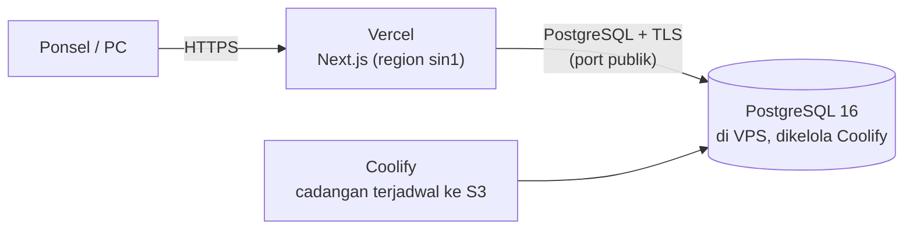

# 09 — Deployment & Operasional

## 1. Arsitektur

- **Vercel** menjalankan seluruh aplikasi Next.js (halaman, server actions, API).
- **VPS dengan Coolify** hanya menjalankan resource **PostgreSQL 16**: SSL, port publik, dan
  cadangan diatur dari dashboard Coolify. Datanya (harga beli, riwayat) tetap di server sendiri.
- Domain aplikasi (`simaset.<domain>`) menunjuk ke Vercel dan tertulis di QR, jadi harus tetap.

## 2. Variabel lingkungan (Vercel, hanya lingkungan *Production*)

| Variabel | Isi |
|---|---|
| `DATABASE_URL` | `postgresql://<user>:<sandi>@<host-vps>:<port-publik>/<db>?sslmode=require&uselibpqcompat=true` |
| `AUTH_SECRET` | Acak, ≥ 32 byte (`openssl rand -base64 32`) |
| `APP_URL` | `https://simaset.<domain>`, dipakai di QR |
| `DB_POOL_MAX` | `3` (setiap instance serverless memegang kolam kecil) |

`uselibpqcompat=true` membuat `sslmode=require` berarti "terenkripsi tanpa memeriksa CA", cocok
dengan sertifikat bawaan Coolify yang bukan dari CA publik. Preview dan Development **dibiarkan
kosong**: `scripts/vercel-build.sh` hanya menjalankan migrasi bila `VERCEL_ENV=production` dan
memakai URL tiruan untuk build lain, jadi preview tidak pernah menyentuh database.

## 3. Pembaruan

Push ke `main` → CI → Vercel membangun dari `vercel.json`: `scripts/vercel-build.sh` menjalankan
`prisma migrate deploy` (hanya Production) lalu `next build`. Migrasi berjalan **sebelum** versi
baru menerima lalu lintas, jadi migrasi harus kompatibel mundur satu versi (*Instant Rollback* di
Vercel lalu aman).

## 4. Cadangan

Harian, lewat **Coolify**: buka resource PostgreSQL → **Backups** → tambah jadwal (mis. `0 2 * * *`),
simpan ke S3 (Cloudflare R2, Backblaze B2, dan sejenisnya) agar salinan ada di luar server. Uji
pemulihan sekali sebelum data sungguhan masuk, lalu tiap beberapa bulan.

`scripts/backup.sh` dan `scripts/restore-check.sh` tetap ada untuk database dev
(`COMPOSE_FILE=docker-compose.dev.yml`): `pg_dump` ke `./backups/` dan uji pemulihan ke basis
data sementara.

## 5. Pemantauan

- `GET https://simaset.<domain>/api/health` memeriksa koneksi DB; pasang di uptime-checker gratis.
  503 berarti Vercel hidup tetapi database tidak terjangkau.
- Log aplikasi: Vercel → Logs. Log dan disk database: dashboard Coolify.
- **Galat tak terduga** dilaporkan ke Sentry bila `NEXT_PUBLIC_SENTRY_DSN` terisi di Vercel
  (hanya Production). Yang dikirim: pesan galat dan jejak tumpukannya; tidak ada cookie, header,
  isi form (kata sandi), query pencarian, atau data pengguna. Galat yang disengaja (validasi,
  409, izin) bukan galat tak terduga dan tidak dikirim. Kosong = tidak mengirim apa pun.
- Layar galat berbahasa Indonesia dengan tombol "Coba lagi" dan kode rujukan menggantikan halaman
  galat bawaan Next.

## 6. Keamanan database yang terbuka

Alamat IP Vercel tidak tetap, jadi database dapat dijangkau dari internet: pakai kata sandi
panjang acak, aktifkan SSL di Coolify, dan hanya buka satu port publik untuk database itu.
Opsional: paket Vercel dengan *Static IPs* memungkinkan firewall VPS membatasi port tersebut.

## 7. Daftar periksa go-live

- [ ] HTTPS aktif di domain aplikasi, kamera memindai di ponsel sungguhan
- [ ] Database menolak koneksi tanpa SSL; Preview/Development di Vercel tidak punya `DATABASE_URL`
- [ ] Deploy produksi pertama menerapkan migrasi; `/api/health` menjawab `{"ok":true}`
- [ ] SUPERADMIN dibuat, 3 akun lain dibuat lewat UI, kata sandi awal sudah diganti
- [ ] Trigger append-only pada `item_logs` dan `maintenance_records` aktif (uji: UPDATE/DELETE ditolak)
- [ ] Cadangan Coolify berjalan ke S3 **dan** pemulihan teruji
- [ ] Satu label lolos satu siklus sterilisasi dan masih terbaca
- [ ] Alur set (Operasi → CSSD → Operasi), pengeditan alat besar oleh Operasi, tampilan Alkes, dan satu catatan maintenance dicoba oleh petugas sungguhan
- [ ] Impor data awal ([14](14-impor-csv.md)) diuji pada salinan basis data dan hasilnya dicocokkan dengan daftar sumber
