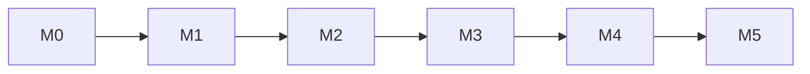

# 10 — Roadmap

Satu rilis, sekitar **3 minggu** untuk satu pengembang (perkiraan awal). Tidak ada
pembagian MVP/v1.1 karena lingkupnya sudah kecil.

## M0 — Fondasi (± 3 hari)

- Repo, Next.js, Biome, Prisma, Docker Compose lokal, CI
- Skema 4 tabel + migrasi + pencabutan hak `item_logs`
- Auth.js, 4 peran, `permissions.ts`, `pnpm user:create` (SUPERADMIN pertama)
- Halaman Pengguna (SUPERADMIN): tambah, ubah peran, nonaktifkan, reset kata sandi, ganti kata sandi awal
- Halaman login dan kerangka layout

**Selesai bila:** SUPERADMIN dapat membuat akun tiga peran lain, dan masing-masing dapat login serta melihat halaman sesuai perannya.

## M1 — Barang & Isi (± 4 hari)

- Daftar, cari, tambah (dengan `route`), ubah, arsip/pulihkan
- Isi wadah (tambah/ubah/hapus baris)
- Log `REGISTER`, `EDIT`, `ARCHIVE`, `RESTORE`
- Penguncian `version`

## M2 — QR, Label, Pindai (± 3 hari)

- Endpoint QR, rute `/i/[code]` dengan alihan login
- Cetak label tunggal dan lembar A4
- Pemindai kamera dan pencarian cadangan

## M3 — Alur Kirim & Kembali (± 4 hari)

- `send()` (tujuan menurut `route`) dan `return()` (dari CSSD maupun Alkes), bersyarat + atomik
- Layar CSSD: edit jumlah + kembalikan dalam satu simpanan; Alkes: kembalikan
- Nama petugas (diingat di perangkat)
- Tes konflik: kirim ganda, kembali ganda, versi basi

## M4 — Tampilan Alkes & Riwayat (± 2 hari)

- Beranda dengan tiga hitungan (Operasi/CSSD/Alkes), daftar, filter lokasi, "lama di lokasi"
- Linimasa riwayat dengan perubahan jumlah
- Pastikan tombol dan izin sesuai peran + lokasi (dan server menolak sisanya)

## M5 — Penyebaran & Uji Lapangan (± 3 hari)

- Server, Caddy, HTTPS, cadangan + uji pemulihan
- Uji label di sterilisasi sungguhan
- Uji coba kedua jalur dengan petugas Operasi, Steril, Alkes; perbaiki alur yang membingungkan

## Ketergantungan

## Setelah rilis (hanya bila terbukti perlu)

Ekspor CSV, peringatan barang terlalu lama di CSSD, standar jumlah isi wadah (untuk
menandai kekurangan otomatis), (manajemen pengguna sudah masuk rilis).

## Risiko jadwal

| Risiko | Dampak |
|---|---|
| Label gagal sterilisasi | Bahan label perlu diganti; uji **lebih awal** (mulai di M2) |
| Daftar isi wadah sangat panjang | Antarmuka edit perlu diperbaiki (mis. tempel banyak baris sekaligus) |
| Petugas tidak memindai | Perbaikan alur, bukan fitur baru |
