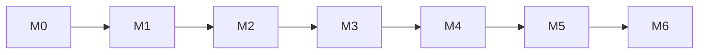

# 10 — Roadmap

Satu rilis, sekitar **4 minggu** untuk satu pengembang (perkiraan awal; maintenance dan
detail pembelian menambah ±1 minggu dari rencana sebelumnya).

Setiap langkah di bawah dikerjakan dengan **commit kecil dan langsung di-push** (lihat
`CLAUDE.md`): build → commit → push; ada error → perbaiki → commit → push.

## M0 — Fondasi (± 3 hari)

- Repo, Next.js, Biome, Prisma, Docker Compose lokal, CI
- Skema 5 tabel + migrasi + trigger append-only untuk `item_logs` dan `maintenance_records`
- Auth.js, 4 peran, `permissions.ts`, `pnpm user:create` (SUPERADMIN pertama)
- Halaman Pengguna: tambah, ubah peran, nonaktifkan, reset, ganti kata sandi awal
- Login dan kerangka layout

**Selesai bila:** SUPERADMIN dapat membuat tiga akun lain, dan masing-masing dapat login serta
melihat halaman sesuai perannya.

## M1 — Barang & Isi (± 5 hari)

- Daftar, cari, tambah, ubah, arsip/pulihkan
- Form lengkap: identitas, kamar, jumlah/rusak, detail alat, pembelian
- Isi wadah (nama, merek, jumlah, rusak, catatan) dengan editor daftar panjang
- Log `REGISTER`, `EDIT`, `ARCHIVE`, `RESTORE`; penguncian `version`

## M2 — QR, Label, Pindai (± 3 hari)

- Endpoint QR, rute `/i/[code]` dengan alihan login
- Cetak label tunggal dan lembar A4
- Pemindai kamera dan pencarian (kode, nama, merek, seri, kamar)

## M3 — Alur Kirim & Kembali (± 4 hari)

- `send()` (hanya barang yang perlu sterilisasi) dan `return()` dari CSSD — bersyarat + atomik
- Layar CSSD: edit jumlah + kembalikan dalam satu simpanan
- Nama petugas (diingat di perangkat)
- Tes konflik: kirim ganda, kembali ganda, kirim barang tanpa sterilisasi, versi basi, peran × lokasi

## M4 — Maintenance (± 4 hari)

- Tabel `maintenance_records`, `maintenance.service.ts`
- Tiga form (perbaikan, pemeliharaan, kalibrasi) dengan validasi Zod per jenis
- Tab Maintenance di halaman barang; jatuh tempo berikutnya; pembaruan jumlah rusak
- Tes: semua peran yang login dapat mencatat; pengguna nonaktif ditolak

## M5 — Beranda & Riwayat (± 2 hari)

- Hitungan Operasi/CSSD/Rusak/Jatuh tempo, daftar, filter; Alkes hanya melihat
- Linimasa riwayat dengan perubahan jumlah

## M6 — Data Awal, Penyebaran & Uji Lapangan (± 4 hari)

- `pnpm import:csv`; uji dengan data contoh ([12](12-data-contoh.md))
- Server, Caddy, HTTPS, cadangan + uji pemulihan
- Uji label di sterilisasi sungguhan
- Uji coba alur set, pengeditan alat besar, tampilan Alkes, dan maintenance dengan petugas Operasi, Steril, Alkes

## Ketergantungan

M2 (label) dapat dimulai paralel dengan M1 setelah skema barang jadi, dan uji bahan label
sebaiknya dimulai sejak M2.

## Setelah rilis (hanya bila terbukti perlu)

Ekspor CSV/Excel, peringatan barang terlalu lama di CSSD, standar jumlah isi wadah (menandai
kekurangan otomatis), notifikasi jatuh tempo, work order maintenance.

## Risiko jadwal

| Risiko | Dampak |
|---|---|
| Label gagal sterilisasi | Bahan label perlu diganti; uji **lebih awal** |
| Daftar isi sangat panjang (ratusan baris) | Editor perlu pencarian, tempel massal |
| Data awal hanya ada sebagai PDF | Impor tertunda sampai berkas Excel diperoleh |
| Petugas tidak memindai | Perbaikan alur, bukan fitur baru |
| Form maintenance dianggap terlalu panjang | Kurangi field wajib setelah uji coba |
